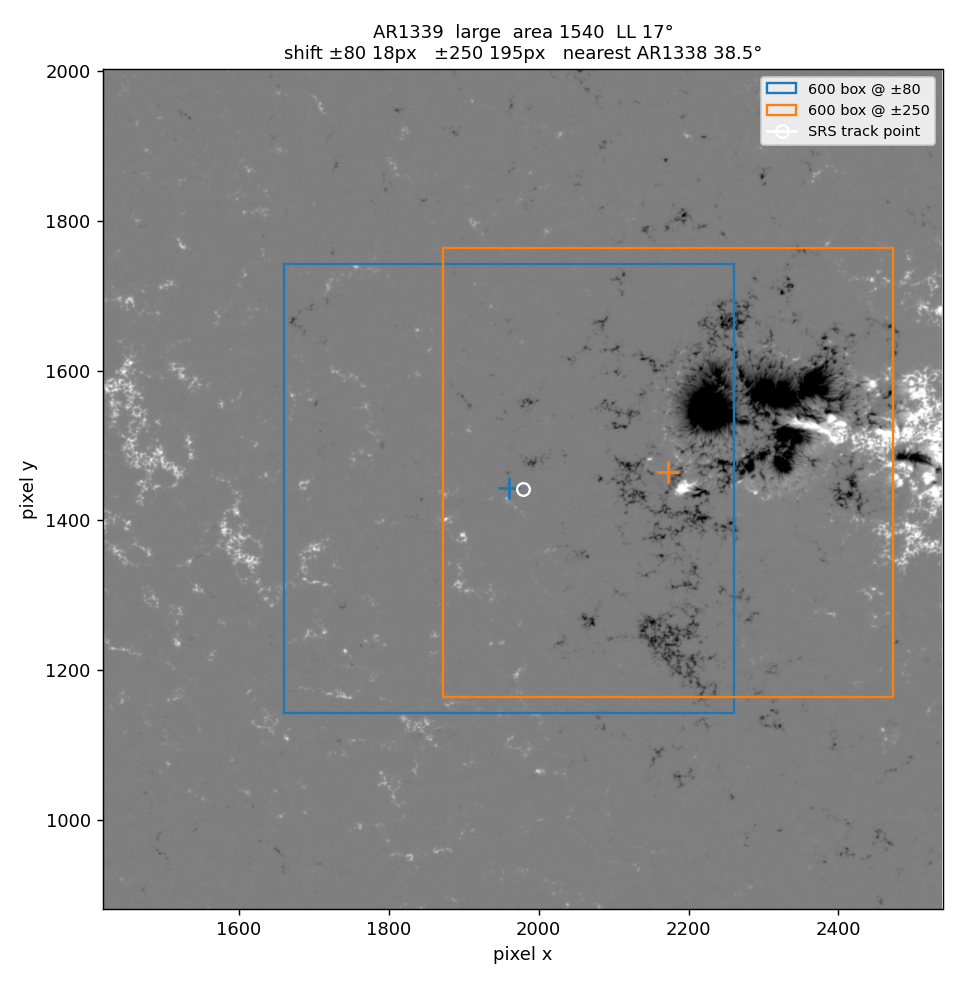
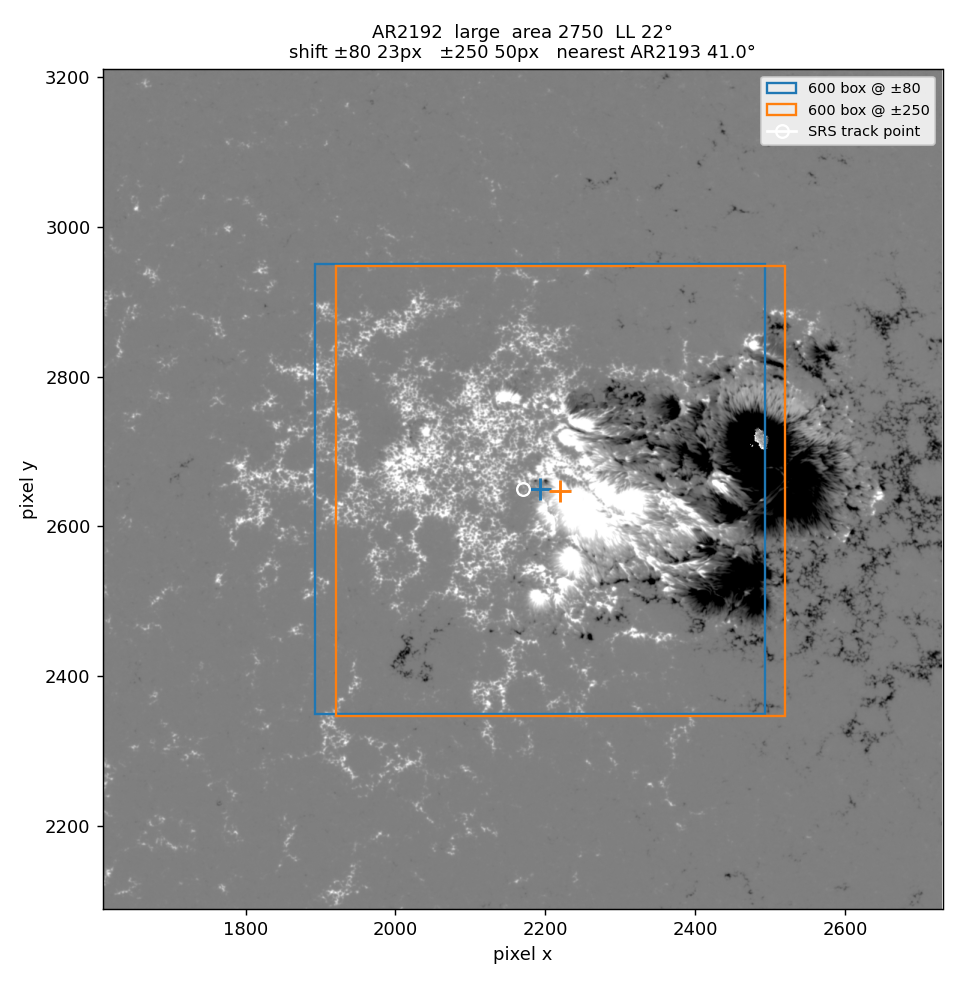
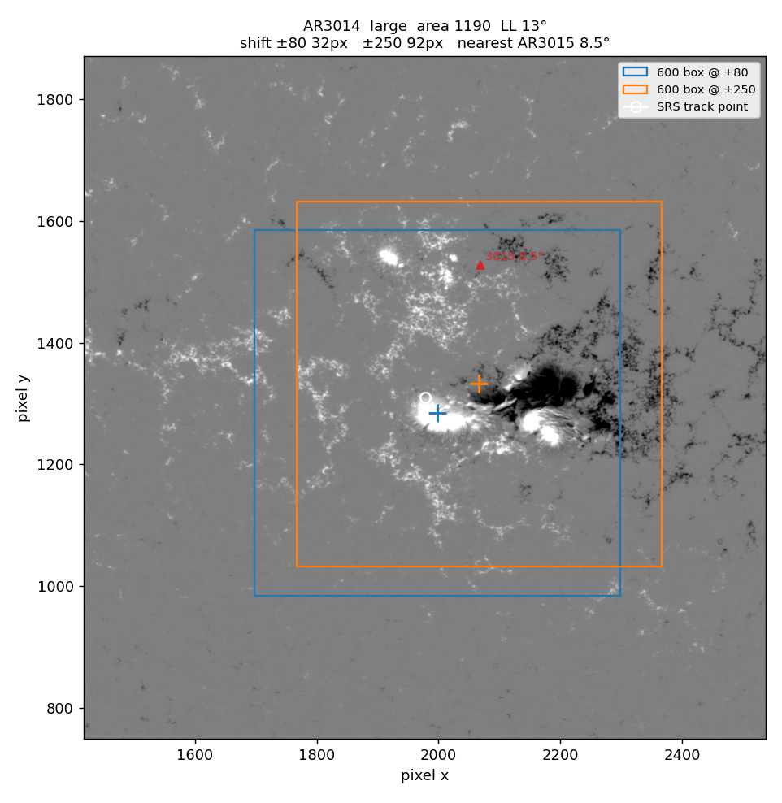
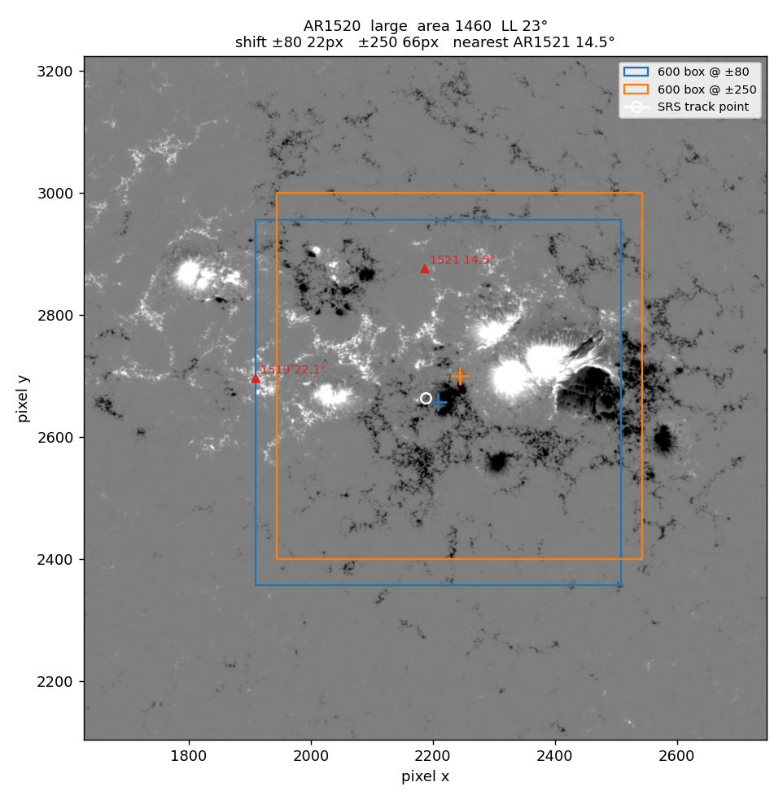
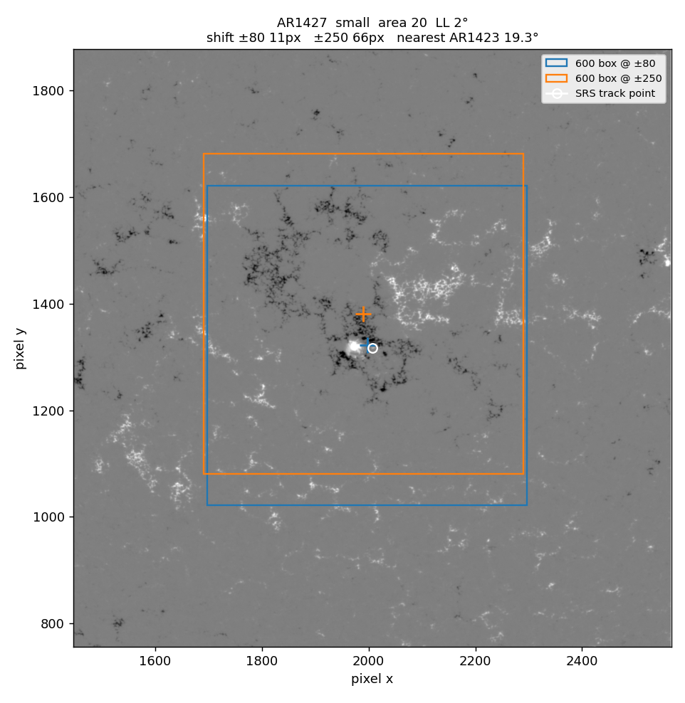

# 裁剪锚点：搜索半径从 ±80 试到 ±250

只讨论定锚那一帧的搜索框。活动区整段寿命仍用一个卡林顿坐标裁剪，视频不会逐帧改中心。较差自转做过，演化视频会晃，这条轨迹保持卡林顿周期。

本文是一次定锚帧上的试算，没有重裁 `fits_600`。

## 现在的定锚

代码在 `step2_crop_active_regions.py`。

1. 取该活动区 SRS 第 I 部分里日面经度绝对值最小、且当天有磁图的那一天。
2. 把这一天 00:00 的日面经度按约每天 13.2°、再乘纬度余弦外推，在当天磁图里取最靠近日面中心的一帧，用这一帧的时刻把当天的日面经纬度换成卡林顿坐标。
3. 在这一帧上，以该卡林顿点为中心，在 ±80 像素内对 `|B| > 100 G` 的像素求 `|B|` 加权重心。
4. 重心若离跟踪点超过 150 像素，就丢掉，退回跟踪点。重心再写回卡林顿坐标，之后每一帧都切在这个点上。

±80 像素的方框里，重心离中心最远大约是 113 像素。150 像素这条退回条件在现有半径下不会发生。HMI 像元约 0.504 角秒，±80 像素约 ±40 角秒，日面中心附近大约 ±2.4°。600×600 的裁剪半径是 300 像素，大约 9°。

SRS 的 `LL` 是经度跨度。`LL = 22°` 大约 730 像素，比 600 像素的窗口还宽。特别大的活动区即使中心找对，两端也会出画。

## 想试的改动

定锚帧和卡林顿轨迹不动，只把第 3 步的搜索半径从 ±80 像素改成 ±250 像素。±250 像素大约 ±7.5°。阈值仍是 `|B| > 100 G`。

放大之后，150 像素的退回条件会开始起作用。只改半径、保留这条退回，大的修正会被丢掉。

## 可能一起做的处理

试算之后，这几条处理对应的是不同的失败情况，不能互相替代。

1. **同步放宽或去掉 150 像素退回。** 本样本里唯一超过 150 像素的修正是 AR1339，移动 195 像素，也是大活动区里收益最大的一次。保留退回，这次修正不会进数据。
2. **用当天其他活动区的 SRS 位置做遮罩。** 某个强场像素若离另一个编号更近，就不参与重心。适合邻区已经落进 ±250 窗口的情况，例如 AR1520 的邻区在 212 像素处。
3. **把阈值从 100 G 提到 200–300 G。** 用来压住小活动区周围的网络场。这一档本次没有另算重心，只作为下一步可试的参数。
4. **改成连通域要单独看。** 只保留离跟踪点最近的那一块强场，能把 AR1427 这类小黑子留在原处。AR1339 的跟踪点落在空网上，最近的连通域就是这块空网，离真实区域大约 217 像素。这条规则会留在空网上，接不住这次需要的修正。

## 这次怎么比

10 个已经裁进数据集的活动区。5 个大区，SRS 面积 1150–2750、`LL` 13°–23°。5 个小区，面积都是 20、`LL` 2°–5°。每个区只打开定锚那一帧全日面磁图，分别用 ±80 和 ±250 求重心，画出两个 600×600 的框。

图是全日面数组的存储方向，没有转成上北左东。蓝框是 ±80 的裁剪，橙框是 ±250 的裁剪，白圈是未经重心修正的跟踪点。

表里的距离都是像素：

- **位移**：重心相对跟踪点移动了多远。
- **两心距**：两个重心彼此差多远。
- **到主体**：相对 ±500 像素内、`|B| > 100 G`、且比其他编号更近的那些像素的重心。
- **框内通量**：上述强场通量落进 600×600 框的比例。
- **连通域差**：±250 的整框重心，离「最近跟踪点的那一块连通域」有多远。差得大，说明整框重心和跟踪点所在的那块不是同一个结构。

| 编号 | 面积 | LL | 最近邻区 | ±80 位移 | ±250 位移 | 两心距 | ±250 被 150 px 退回 | 到主体 ±80 / ±250 | 框内通量 ±80 / ±250 |
|------|------|----|----------|----------|-----------|--------|---------------------|-------------------|---------------------|
| 2192 | 2750 | 22° | 41°，919 px | 23 | 50 | 27 | 否 | 134 / 107 | 0.74 / 0.81 |
| 1339 | 1540 | 17° | 38°，1199 px | 18 | 195 | 213 | 是 | 285 / 80 | 0.40 / 0.90 |
| 1520 | 1460 | 23° | 14.5°，212 px | 22 | 66 | 55 | 否 | 164 / 135 | 0.80 / 0.87 |
| 3014 | 1190 | 13° | 8.5°，236 px | 32 | 92 | 84 | 否 | 76 / 44 | 0.89 / 0.90 |
| 3354 | 1150 | 18° | 7.6°，208 px | 19 | 14 | 16 | 否 | 7 / 19 | 0.98 / 0.98 |
| 1181 | 20 | 2° | 17°，411 px | 23 | 89 | 68 | 否 | 152 / 85 | 0.65 / 0.73 |
| 1427 | 20 | 2° | 19°，630 px | 11 | 66 | 59 | 否 | 52 / 22 | 0.84 / 0.83 |
| 1717 | 20 | 5° | 24°，790 px | 33 | 39 | 15 | 否 | 52 / 45 | 0.63 / 0.63 |
| 1255 | 20 | 3° | 9°，296 px | 36 | 44 | 45 | 否 | 133 / 138 | 0.85 / 0.83 |
| 1426 | 20 | 4° | 8°，347 px | 23 | 39 | 16 | 否 | 58 / 61 | 0.75 / 0.77 |

原图在 `docs/crop_anchor_check/figures/`。复算脚本是 `docs/crop_anchor_check/check_anchor_radius.py`。

## 图上看到的

**AR1339：±250 把框从空网挪到活动区上。** 邻区在 38° 以外。±80 的框切掉了右侧黑子，±250 把它包进来，框内强场通量从 0.40 升到 0.90。这次移动 195 像素，会被现有的 150 像素退回丢掉。

**AR2192：±250 仍够不着主黑子。** 两个重心都停在前导黑子西侧的谱斑里，黑子贴在 600 框的右缘。主黑子离跟踪点大约 300 像素以上，已经出了 ±250 的搜索框，所以半径放到 250 只向黑子挪了 27 像素。这个区的经度跨度也大于 600 像素，窗口本身装不下整个区。

**AR3014：邻区在窗口里，重心仍朝本区的两极中间移动。** 邻区 AR3015 在跟踪点北面约 236 像素。橙色重心向东移向黑子，没有往北被邻区拉走。框内通量本来就有 0.89。

**AR1520：邻区落在 ±250 里面，整框重心和跟踪点所在的连通域差 91 像素。** 橙色框多包进了东侧亮斑，也更靠近北面的 AR1521。通量从 0.80 到 0.87，到主体的距离仍有 135 像素。这种邻近复杂区要先做邻区遮罩，再决定是否采用 ±250 的重心。

**AR1427：小区的 ±80 在黑子上，±250 被北面网络场拉走大约 60 像素。** 框内通量从 0.84 降到 0.83。AR1255 同样是 ±80 压在小黑子上，±250 往西南离开黑子；邻区在北面，拉动来自网络场。AR1717、AR1426 两个重心只差 15–16 像素，±250 没有把黑子拉离中心。AR1181 本身是弥散区，±250 移向稍强的一片网络，通量从 0.65 到 0.73。

AR3354 的跟踪点已经在活动区上，两个重心几乎重合，邻区 AR3351 落在框内的弱场里，没有拉动重心。

## 这 10 帧说明的事

跟踪点旁边就是活动区、而且活动区还和 ±250 窗口有重叠时，放大半径能把裁剪中心挪向主体。AR1339 是这样，AR3014 也是这样。

主黑子落在 ±250 之外时，放大到 250 仍然居中不了。AR2192 是这样。再加大半径会把更多邻区和网络场收进来，600 像素的窗口也装不下 `LL ≈ 20°` 的区。

小而密的黑子，±80 已经在黑子上。±250 加上 100 G 的阈值，会去凑周围的网络场。AR1427、AR1255 是这样。

150 像素退回要和半径一起改。本样本里它唯一会否决的，就是 AR1339 这次有用的移动。

连通域规则保得住小黑子，留不住 AR1339 这种跟踪点落在空网上的情况。邻区遮罩针对的是 AR1520 这种邻区已经进窗的重心。阈值提到 200–300 G 还没有在这 10 帧上算过。

因此 ±250 可以继续试，适合做成「半径、退回距离、邻区遮罩、磁场阈值」一起比较的下一次定锚试验。它解决的是跟踪点已经在活动区旁边、但 ±80 窗口不够大的情况。1339 这种跟踪点落在空网上的情况，要先改起点。

## 重裁时改用日面中心那天的起点

改之前，裁剪用的是校正之后的那一个卡林顿坐标。第一天的 SRS 经纬度只用来起步：换成卡林顿坐标，再在这个点最靠近日面中心的一帧上做 ±80 重心校正。校正被接受之后，整段寿命都切在这个新点上；偏移超过 150 像素则退回第一天的点。下面的试算和 `Lo` 表都是按这个旧起点量的。

卡林顿坐标对同一个物理点不变。选日面中心只决定在哪一帧上做这次局部校正，不会把起点换成后面某天的报告位置。活动区从日面边缘长起来时，NOAA 每天写的 Location 不是同一个点，报出的卡林顿经度（SRS 的 `Lo`）会跟着走。±80 大约 ±2.4°，起点若已经偏出这个范围，校正只能在旧点旁边的空网上挪一点。

下面是这 10 个区第一天和「日面经度最接近 0° 的那一天」的 `Lo`。差的是报告点，不是已经重算的重心。

| 编号 | 类型 | 第一天 | 最靠近日面中心 | Lo 差 |
|------|------|--------|----------------|-------|
| 1339 | 大 | 11-02 N22E71，180 | 11-08 N19E05，1240 | −14° |
| 2192 | 大 | 10-18 S13E68，260 | 10-23 S12E06，2700 | −4° |
| 1520 | 大 | 07-08 S15E54，510 | 07-12 S17E06，1320 | −4° |
| 3014 | 大 | 05-16 N21E53，100 | 05-20 N22E04，1100 | −4° |
| 3354 | 大 | 06-27 N15E24，20 | 06-29 N14W03，800 | +2° |
| 1181 | 小 | 03-26 S25E69，10 | 03-31 S26E06，10 | −2° |
| 1255 | 小 | 07-15 N17E45，10 | 07-19 N18W06，20 | −2° |
| 1717 | 小 | 04-06 S10E66，10 | 04-11 S10W01，10 | +1° |
| 1426 | 小 | 02-27 N10E12，20 | 02-28 N11W02，10 | −1° |
| 1427 | 小 | 03-02 N15W01，20 | 同一天 | 0° |

1339 差 14°。现有 ±80 校正只挪了 18 像素，裁剪中心留在空网上。2192、1520、3014 差 4°，也大于 ±80 能补上的范围。3354 虽然是大区，第一天已经在 E24，`Lo` 只差 2°，报告点没有跟着面积从 20 长到 800 而走开。

五个小区的 `Lo` 差是 0–2°，和现有 ±80 校正同一个量级。黑子本身只有几度宽，换起点后框仍盖住原来的区，裁剪结果变化不大。

`step2_crop_active_regions.py` 现在用的就是这个起点：SRS 里日面经度绝对值最小、且当天有磁图的那一天，在这一天最靠近日面中心的一帧上做一次 ±80、`|B|>100 G` 重心，然后仍只用这一个卡林顿坐标切整段寿命。搜索半径、150 像素退回和邻区遮罩仍按上一节另试。

按这个规则重跑全部活动区会改掉已经发布的锚点。2026-11-11 只重裁了 1302、1305、1306、1307，并补上了 2011 年 9 月原先没有目录的区。见 [hmi_hidden_201109.md](hmi_hidden_201109.md)。
